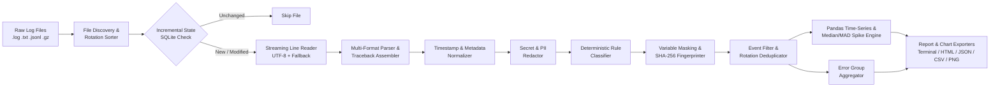

# System Architecture

`python-log-anomaly-analyzer` is designed as a modular, local-first pipeline that processes application logs with bounded memory and deterministic outputs.

## Pipeline Overview

## Module Responsibilities

| Module | Path | Responsibility |
| :--- | :--- | :--- |
| **CLI** | `src/log_analyzer/cli.py` | `argparse` command parsing (`analyze`, `demo`, `validate-config`, `generate-demo`), exit codes (`0`, `1`, `2`). |
| **Config** | `src/log_analyzer/config.py` | TOML loading (`tomllib`), schema validation, regex pre-validation, and default rules. |
| **Models** | `src/log_analyzer/models.py` | Typed dataclasses (`LogEvent`, `ErrorGroup`, `AnomalyAlert`, `AnalysisResult`, `FileIngestionStats`). |
| **Discovery** | `src/log_analyzer/discovery.py` | Directory/glob traversal, chronological ordering of rotated logs (`.log.2.gz` → `.log.1` → `.log`), streaming reader. |
| **Parsers** | `src/log_analyzer/parsers.py` | Auto-detection and parsing for Python, ISO-8601, JSONL, Syslog, Apache, Nginx, and custom regexes; multiline traceback assembly. |
| **Normalizer** | `src/log_analyzer/normalizer.py` | Timezone-aware UTC timestamp conversion and extraction of exception types, error codes, source locations, and request IDs. |
| **Security** | `src/log_analyzer/security.py` | Pre-storage secret/PII redaction, HTML escaping, and OWASP CSV formula injection protection. |
| **Classifier** | `src/log_analyzer/classifier.py` | Priority-ordered regex rule matching across 10 deterministic failure categories with grounded investigation hints. |
| **Fingerprinter** | `src/log_analyzer/fingerprinter.py` | Ordered masking of variable tokens (`<UUID>`, `<REQ_ID>`, `<IP>`, `<HEX_ADDR>`, `<DURATION>`, `<NUM>`) and SHA-256 group hashing. |
| **Anomaly** | `src/log_analyzer/anomaly.py` | Pandas time-bucket aggregation, rolling baseline comparison, and robust Median/MAD outlier detection. |
| **Aggregator** | `src/log_analyzer/aggregator.py` | Filtering, rotated overlap deduplication, error group metrics, and high-priority triage ranking. |
| **Visualizer** | `src/log_analyzer/visualizer.py` | Matplotlib generation of 6 analytical PNG charts and base64 data URIs for standalone HTML embedding. |
| **Reporter** | `src/log_analyzer/reporter.py` | Terminal executive summary, CSV tables, JSON report, and interactive standalone offline HTML dashboard. |
| **Persistence** | `src/log_analyzer/persistence.py` | Optional SQLite tracking (`processed_files` and `analysis_runs`) for `--incremental` execution. |
